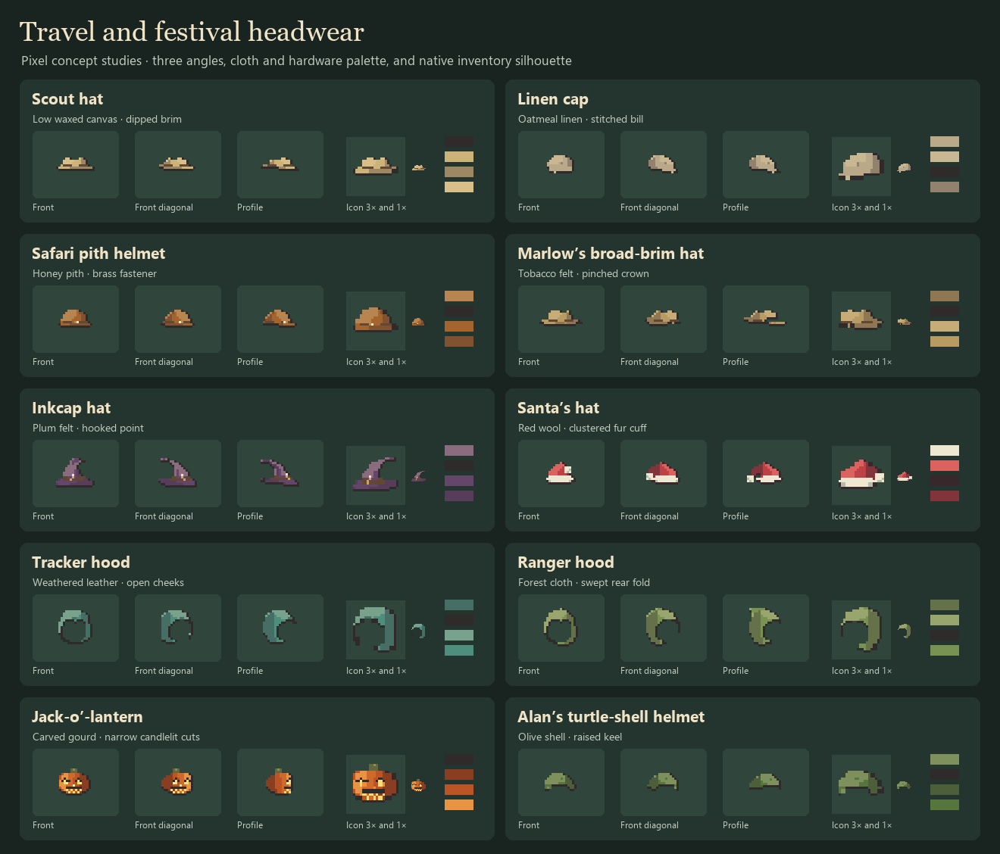

# Travel and festival headwear concepts

Target the existing Wildbound skull anchor and one-world-pixel grid. Use a raised read on the lit side and one continuous shadow under the brim. Keep brim edges thin, the eye line open, and the hat scale close to the bare head. The plated, sewn, leather, felt, fur, and vegetable surfaces should each have a distinct light shape. Design drafts should show a matched front and three-quarter view and a separate 24 × 24 icon.

| Asset | Silhouette and material | Detail and turn |
| --- | --- | --- |
| Scout hat `hat` | A low tan waxed-canvas field hat with a small crease and a short dipped front brim | A lightly raised side fold and dark sewn band separate it from the broader Marlow hat. The brim becomes shallow in profile. |
| Linen cap `linen_cap` | An oatmeal half-dome fitted to the skull with a forward bill | One center seam meets a stitched band. The bill projects forward in profile and disappears behind the crown. |
| Safari hat `safari_hat` | A honey pith dome with a rounded helmet-like shoulder and a compact downward brim | A dark russet headband with one brass buckle follows the curve. One rim step on the near side shows the light cork edge. |
| Marlow’s broad-brim hat `marlow_hat` | A low felt crown with a pinched top, the widest shallow brim here, and one gently turned-up side | A dark tobacco band and dull brass clasp keep the face clear. The long brim tapers toward the rear and has just one thin dark underside. |
| Inkcap hat `alley_inkcap` | Plum felt cap with a low crooked hooked point, short upturned side, and a narrow brim | A compact brass nib pin sits over the near temple. Its angular point and jewel-toned fabric separate it from the round cloth hats. |
| Santa hat `santa_hat` | A soft red cap with a drooping rear point and a short cream fur cuff | A joined round pom changes sides correctly during the turn and hangs behind at the rear. Keep fur in broad clustered steps along the cuff. |
| Leather hood `leather_hood` | Close brown weathered leather over a broad arched face opening with short cheek edges | One seam follows the low dome. Rear pieces fold into a compact V and the hood sits close to the neck. |
| Ranger hood `ranger_hood` | A low forest-green folded cloth cowl with a distinct swept point and fitted face arch | A narrow leaf-toned fold turns down the rear toward the nape. Cloth groups are larger and softer than the leather hood’s stitched planes. |
| Jack-o’-lantern `jack_o_lantern` | A squat rust-orange gourd around the head, with a short sage stem and broad lobes | Slanted lit eye cutouts and a stepped grin face forward. The profile keeps one cutout, rear keeps ribs, and the worn gourd stays compact and low. |
| Alan’s turtle-shell helmet `alan_turtle_helmet` | Olive shell cloche, arched over the brow and tapered toward the back | A few large shell planes and a raised uneven keel follow the turn. The dark low rim lets the face remain visible. |
