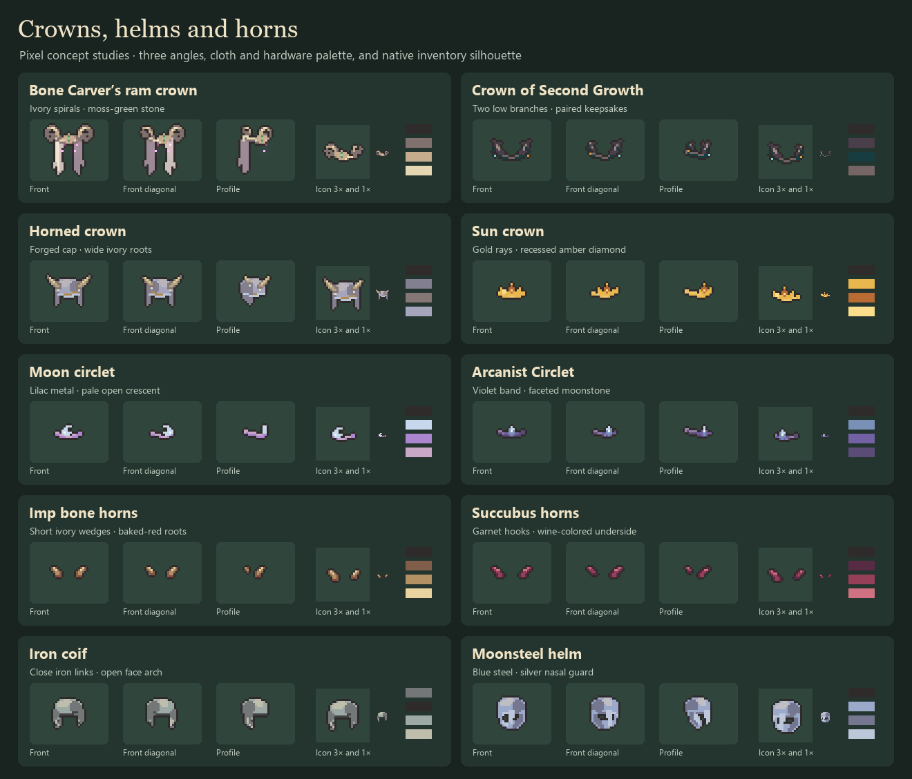

# Crowns, circlets, helms, and horns

Each study starts on the current skull anchor at one logical pixel per cell. The same head wears each piece in S, SW, W, NW, N, NE, E, and SE. Turn the volume and its attachments together. Keep the player's expression visible under open headgear and reserve darker values for recessed rims or overlapping material.

| Item | Shape, material, and identifying feature |
| --- | --- |
| **Bone Carver’s ram crown** | Give each temple a compact carved spiral with a dark recessed curl and a pale upper ridge. Keep a narrow ivory brow setting with one moss-green stone. Separate the pale mane at the cheek and nape and keep the NPC’s pink eye effects. |
| **Crown of Second Growth** | Curl exactly two low branches outward from a narrow teal-wrapped brow, with one inward tine on each stem. Raise an uneven lighter edge on the wood. Place a small cyan bead and an amber keepsake on the outward stems. The wearer’s forehead and eyes stay open. |
| **Moon circlet** | Use a thin, low lateral band with an open pale crescent in its center. Separate lilac metal shadow from silver moonlight. The crescent foreshortens at profile and disappears behind the rear band. |
| **Horned crown** | Form a rounded forged cap and a swept cheek guard around an open face. Two wide-rooted ivory tips sweep out and climb toward the outer edges. Use cool blue-gray across the broad shielded plane and expose a brass fastener where horn meets metal. |
| **Iron coif** | Shape a tight, rounded iron dome, curved brow and close nape skirt. Leave an uninterrupted arch around the eyes and face. Show chainmail with small overlapping mid-gray clusters along the cheek and rear hem. |
| **Moonsteel helm** | Use a polished blue-steel shell with a narrow eye opening, projecting silver nasal guard, and angular cheek plates. Close the rear shell with a simple rivet and a cool latched seam. |
| **Sun crown** | Keep a low curved brow band with three rising rays. Cut the central amber gem as a diamond between a warm rim light and a dark orange recess. Show the back of the ray crest above a lower rear band. |
| **Arcanist Circlet** | Bend a slender deep-violet band around one pale faceted moonstone. The jewel’s four-point cut reads above the forehead, becomes thinner at profile, and stays off the rear band. |
| **Imp bone horns** | Use short bone wedges that grow from compact baked-red bases. Put the pale ends on a warm ivory ridge. Bring the far horn inward and upward as it recedes around the head. |
| **Succubus horns** | Draw a pair of longer garnet hooks with a thick base, rising bend, and slim returning tip. Separate the wine-dark underside from a pink-red ridge. Both roots meet the hairline while the far horn recedes. |

The silhouettes use the prior [headwear annotations](../../history/2026-10-17-headwear-marked-revisions.md), the [Keeper’s low paired branches](../../history/2026-10-06-keeper-antlers-amulet.md), and the [Bone Carver’s native art](../2026-10-26-cute-humanoid-and-bone-carver-study.md) as fit references. The [native painter](../../../src/headwear-crowns-art.mjs) provides a compact 24 × 24 inventory pose and separate worn views. Review both in the player renderer at native size and with nearest-neighbor enlargement.
