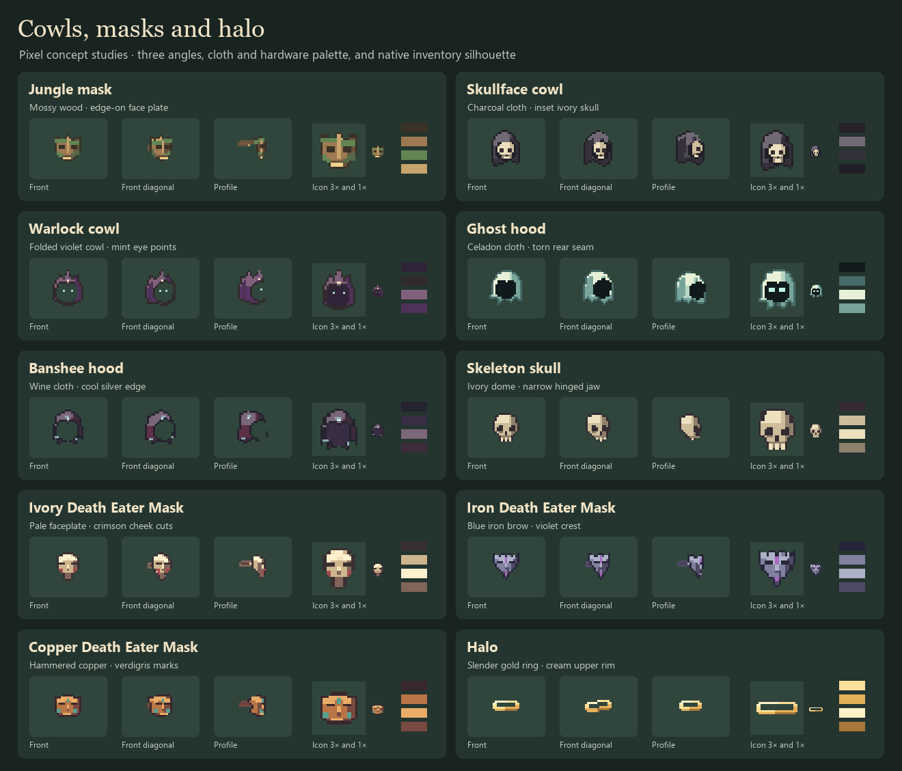

# Wildbound hoods, masks and halo

These studies use the existing head pivot and eight gameplay facings. The main light comes from the screen's upper left. The inventory art gets its own placement within the 24×24 native tile. The visible face changes with the turn, and rear views show the construction that holds the item in place.

| Item | Silhouette and material | Detail to keep readable |
| --- | --- | --- |
| Jungle mask | A stepped wood plate with a broad brow, narrow jaw and moss-dyed coloring. Its near side projects away from the strap in profile. | Small eye cuts and a single pale carving down the center. The rear shows a tied reed band. |
| Skullface cowl | A charcoal hood with a low pointed crown and an uneven cloth fall around the jaw. The inset ivory face has its own skull silhouette. | Dark sockets, a short tooth ridge and one broken rear seam. |
| Warlock cowl | Three folded violet cloth points lead into a recessed living face and a snug lower collar. The cloth ramp follows the gear dye. | A small upper clasp and two mint eye pixels in the front. The rear fold replaces all facial marks. |
| Ghost hood | Pale celadon cloth wraps a dark opening and ends in uneven torn tabs. The lighter left fold belongs to the same palette as the spectral robe. | The existing rig owns the luminous eyes and trail. The inventory tile uses a pair of still eyes. The rear has a pale folded seam. |
| Banshee hood | A swept wine-colored crown and a close cheek line frame the existing face. The outer fabric follows the gear dye. | Cool metal at the crown and hem suggests a narrow embroidered silver edge. The inverted rear seam has no face detail. |
| Skeleton skull | An ivory cranium over a tighter jaw, attached at the same pivot as the old equipment skull. Profile exposes a cheek and a single socket. | Separate socket clusters and three small teeth. The back shows the cranium and lower bone seam. |
| Ivory Death Eater mask | A rounded pale brow descends into a long pointed cheek. The side edge remains thin where the faceplate turns away. | Crimson cheek cuts and a small crimson clasp in the rear. |
| Iron Death Eater mask | A broad iron brow rises into angular temples and falls to a pointed chin. Slate and violet separate the bevels. | A short violet crest line and an angular rear buckle. |
| Copper Death Eater mask | A broad lip and flared cheeks make the hammered copper face wider at the bottom. A warm highlight follows the upper metal plane. | Verdigris at the cheeks and paired hardware on the rear strap. |
| Halo | A narrow open gold ring rides just above the crown. Its camera profile remains shallow and the far rim stays light. | A brighter cream edge catches the upper-left light, with brass under the near rail. |

The native painter lives in [headwear-masks-art.mjs](../../../src/headwear-masks-art.mjs). Approve fit in the assembled renderer with short and long hair before treating these as accepted art.
