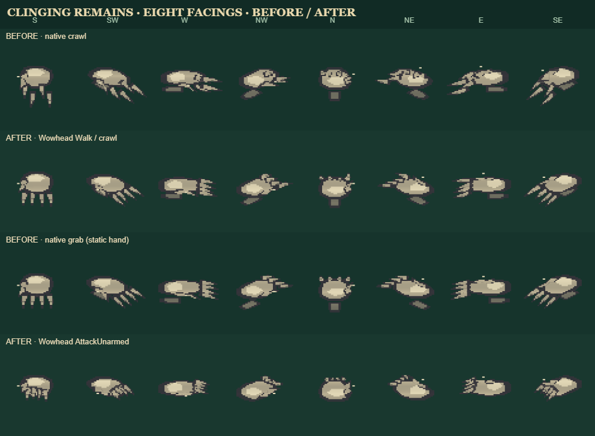

# Clinging Remains: Wowhead hand motion transfer

**Status:** integrated in source and verified with focused tests. No package version changed.

The first and third rows show the prior native procedural crawl and static native grab. The second and fourth rows show the sampled donor Walk and AttackUnarmed motion fitted to the same editable Wildbound rig and unchanged pixels.

## Donor and provenance

- Wowhead NPC 179179, Clinging Remains; model FileDataID **3386315**.
- Source M2: [3386315.m2](https://wow.zamimg.com/modelviewer/live/m2/3386315.m2)
- Parsed as M2 v274 with embedded MD21 tracks; 40 bones and 959 vertices.
- SHA-256: `8bf4c60f801ce2e715160692c742ddbe938c680cc9b3b60941135e94fec66de6`.
- Donor sequence inventory was checked by sequence index, animation ID, duration and M2 alias flag. Walk is sequence 6 / ID 4 (1,033 ms); AttackUnarmed is sequence 8 / ID 16 (1,133 ms). Both are independent tracks with no alias flag.
- Stand is sequence 0 / ID 0; Run sequence 5 / ID 5; CombatWound sequence 7 / ID 9; Death sequence 9 / ID 1. These standard tracks have no alias flag. IDs 213–216 are independent, but their semantics are unknown and their root travel is unusually broad, so they were not imported.

## Skeleton mapping

The mapping follows the M2 parent hierarchy, pivots and direct weighted vertex influence. Source axes are X forward, Y left and Z up; they convert to Wildbound `[Y, X, Z]` with scale 14.

| Wildbound editable joints | Donor bones | Evidence |
| --- | --- | --- |
| `wrist` | 0 | Root/forearm bone; 243 weighted vertex influence units. Its vertical motion is retained for the raised forearm stroke. |
| `palm` | 1 | Independent root; 175 influence units. |
| `finger0..3` | 2, 3, 4, 5 | Four child chains under palm, each with 49–56 influence units. |
| `finger0Mid..3Mid` | 50/50 blend of each base and its distal bone | Target rig has three articulated points per finger while the donor has two; midpoint interpolation fits the donor's distal motion to the existing editable hand. |
| `finger0Tip..3Tip` | 8, 9, 10, 11 | Distal weighted finger bones; 49–61 influence units. |
| `thumbBase`, `thumbTip` | 7, 12 | Weighted thumb bones in the 6→7→12 chain; the connector bone 6 is not used as a target joint. |

The donor's per-frame root translation is removed from palm and digit tracks so their articulation remains relative to the forearm. Wrist motion is retained, and every converted positional channel is limited to ±8 Wildbound pixels; this keeps the donor's broad attack travel fitted to the hand-scale rig instead of separating the wrist from the palm. Source motion is sampled at 24 fps.

## Integration and preservation

`src/creature-packs/eldritch.mjs` merges donor `crawl` and `grab` tracks into the existing `evil_hand` model. Each imported frame includes every editable joint, with unmapped joints at zero. Pixel art, palette, eye color/behavior, rig identity, AI, and the native `idle`, `windup`, `recover`, `hurt`, and `death` clips remain in the model.

Combat now shows the native `windup` warning, plays the imported `grab` attack for a short strike window, then returns to native `recover`. While pursuing, the hand routes to donor `crawl`; idle returns to the existing native idle. The donor's idle, wound and death tracks were not substituted.

The runtime provenance is stored in `animationProvenance` on the editable model. The test round-trips edited joints and native clip keys through JSON and pack replacement, then restores defaults, ensuring the imported tracks and authored rig edits are not lost by the editor's save/restore path.

## Files and validation

- Importer: `scripts/import-clinging-remains-wow-motion.cjs`
- Generated clips/provenance: `src/clinging-remains-wow-motion-data.mjs`
- Runtime integration: `src/creature-packs/eldritch.mjs`
- Focused tests: `tests/creature-packs/clinging-remains-wow-motion.test.mjs`, `tests/creature-packs/eldritch.test.mjs`
- Capture generator: `scripts/review-clinging-remains-wow-motion.cjs`
- Capture: `docs/art/reviews/2026-10-28-clinging-remains-eight-facing-before-after.png`

Focused command passed: `node --test tests/creature-packs/clinging-remains-wow-motion.test.mjs tests/creature-packs/eldritch.test.mjs` — 13 tests passed. This includes finite clip poses, weighted-bone coverage, wrist/finger articulation, attack routing, before/after motion at all eight facings, existing art/palette preservation, and JSON save/restore. The review capture was generated through a muted Electron renderer. No full game build or in-game hardware playtest was run.

## Transfer limits

This is a 2.5D positional retarget onto Wildbound's editable hand joints, not imported mesh skinning or a one-to-one transplant of every donor bone. Distal-to-mid finger points are interpolated to fit the target rig. The native pixels and game behavior remain authoritative; a visual playtest is still useful for tuning if the imported hand feels too subtle or too broad in motion.
