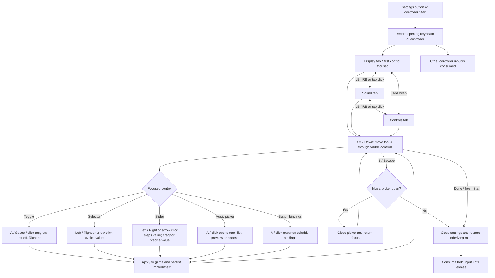

# Camp Settings — interaction flow

The visual layout follows `settings-layout-blockout.png` and the supplied display, sound and controls examples. The portrait sign is 680 design units wide, approximately 1280 high, and scales as one object to fit the window. It has exactly three tabs. The illustrated frame is a transparent asset; the live game remains behind it.

| Surface | Live behavior |
| --- | --- |
| Display | Fullscreen, cel shading, cast shadows, interface scale, board size and event message duration. |
| Sound | Sound enable, music/master/SFX/UI/ambient volume, track selection and preview, night mix, test sound. |
| Controls | Default/alternate/custom bindings, prompt family, analog response curve, radial aim dead zone, X/Y aim inversion, controller attack vibration. Advanced binding details retain all existing remapping. |
| Done | Closes settings. Choices have already applied and persisted. |

Arrow buttons remain clickable but do not become extra controller stops. The native selector or slider is the focus target, so one Up/Down press moves to the next setting. Every tab has its own scroll position reset on selection. The Done button remains outside scrolling content.
