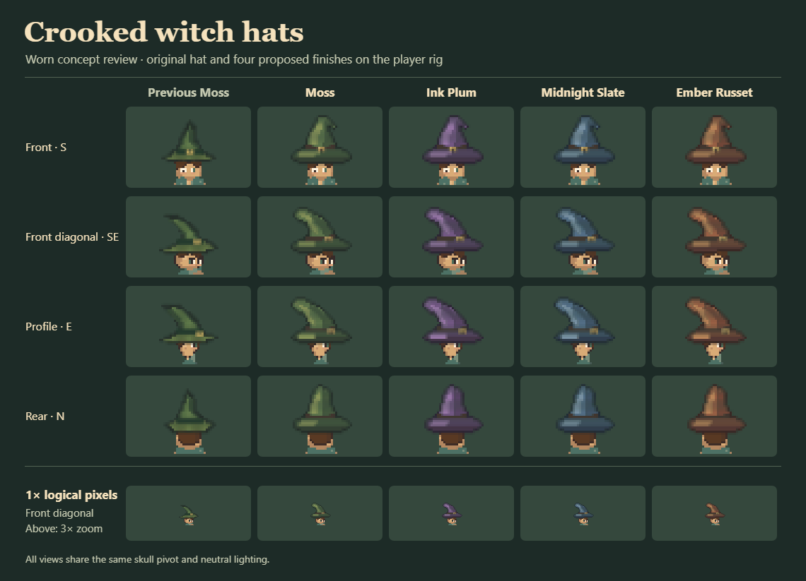

# Crooked witch hats

The Crooked Witch Hat keeps its moss-green felt, broad brim, and brass buckle. Round the base of the crown into a tapered, soft point that folds toward the back of the head. Shape the brim like one piece of felt with an upturned far edge and a darker near underside. A narrow leather band and one small clasp provide the identifying detail.

| Item ID | Finish | Material direction |
| --- | --- | --- |
| `witch_hat` | Moss | Warm olive felt with a muted yellow-green highlight |
| `witch_hat_plum` | Ink Plum | Cool purple felt with a dusty violet highlight |
| `witch_hat_slate` | Midnight Slate | Deep blue-gray felt with a quiet blue highlight |
| `witch_hat_russet` | Ember Russet | Rust-red felt with a warm ochre highlight |

Keep the broad cloth planes under the light. Carry the lit crown into the fold with a few connected steps and darken the underside under the lean. Seat the brim above the eyes around the existing skull anchor. The crown fold recedes with the direction of the wearer. The clasp follows the front of the band and disappears in rear views.

The [earlier annotated headwear turnaround](references/broom-view-markup-2026-10-26.png) gives brim and head-position context. The study compares the prior Moss hat and the proposed family on the same native player head. It includes front, front diagonal, profile, and rear crops at 3×, plus the front diagonal at 1× logical pixels.

The [native hat painter](../../src/witch-hat-art.mjs) holds the shared per-facing shapes and each felt palette. The four finishes were captured on the same default native player in an isolated, muted Electron canvas. The comparison produced 16 updated worn crops and four earlier Moss crops with no renderer errors. The [packaged turnaround](reviews/2026-11-23-witch-hat-turnaround.png) shows the final inventory icons and all eight equipped views.
