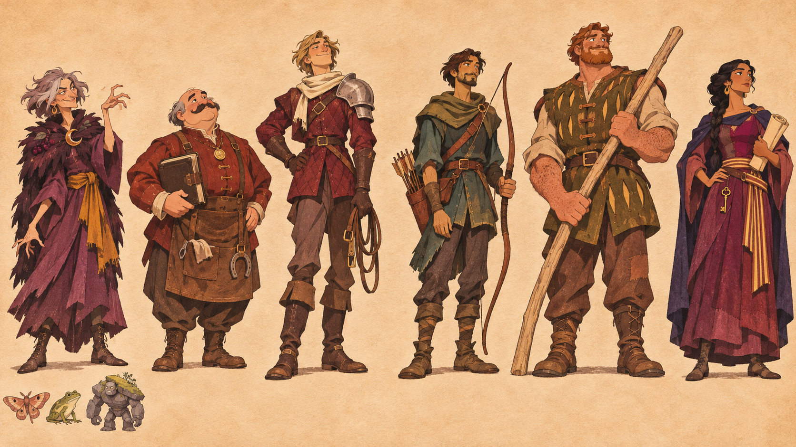
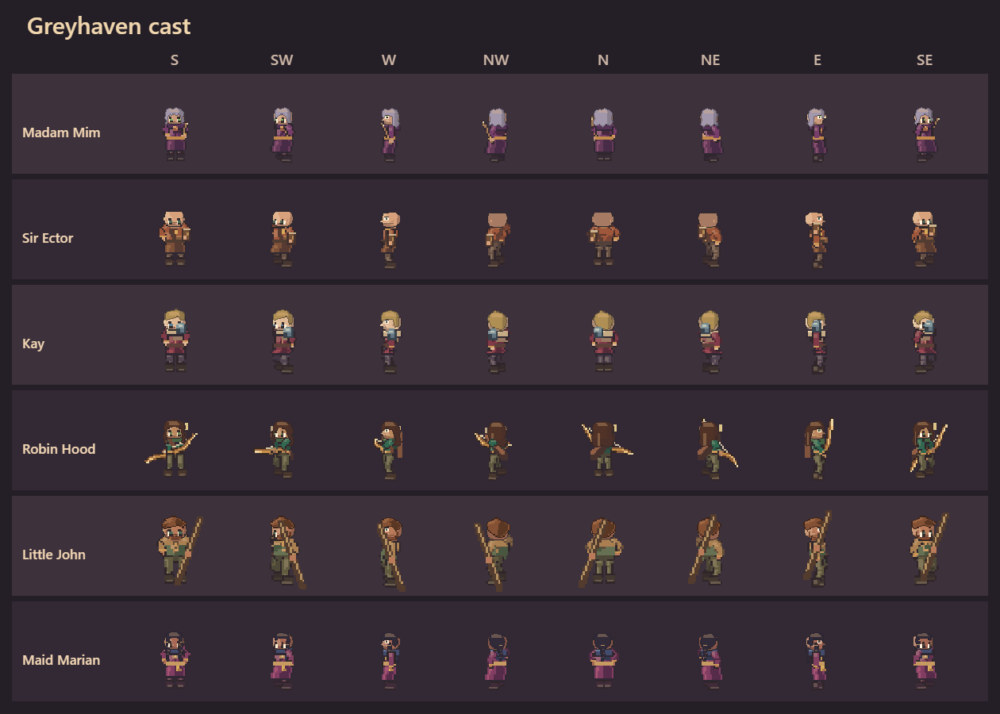

# Greyhaven cast



The cast uses original human designs for Wildbound’s coastal fortress. The references establish character acting and readable silhouettes. The game artwork uses Wildbound’s eight-direction humanoid rig, anatomically placed clothing layers and the existing motion clips.

| Character | Visual reference | Greyhaven sprite |
| --- | --- | --- |
| Madam Mim | [Frank Thomas’s rough animation sequence](https://comics.ha.com/itm/animation-art/production-drawing/the-sword-in-the-stone-rare-madam-mim-rough-animation-drawing-sequence-of-3-by-frank-thomas-walt-disney-1963-/a/7375-19275.s) | Crooked silver hair, crowberry mantle, copper crescent and an ochre sash. |
| Sir Ector | [Bill Peet’s storyboard drawing](https://vegalleries.com/art/walt-disney/144/the-sword-in-the-stone-1963/the-sword-in-the-stone-storyboard-drawing-id-jundis025) and [a full-figure production drawing](https://comics.ha.com/itm/animation-art/production-drawing/the-sword-in-the-stone-sir-ector-animation-drawing-walt-disney-1963-/a/40317-86192.s) | Rounded shoulders, heavy moustache, brass pendant and a stable apron over a russet doublet. |
| Kay | [Kay and Ector production drawings](https://www.icollector.com/Sword-and-the-Stone-Sir-Kay-Sir-Ector-Original-Production-Drawings_i16374072) | Long silhouette and swept hair, with a cream scarf over burgundy riding clothes. |
| Robin Hood | [Disney Animation Research Library’s human and fox studies](https://d23.com/must-see-rare-artwork-from-robin-hood/) | Human archer in a teal tunic, low green hood and russet quiver. |
| Little John | [Original Little John model sheet](https://choicefineart.com/products/robin-hood-original-stat-model-sheet-little-john) | Broad human silhouette, cinnamon beard, tan sleeves and an ash staff. |
| Maid Marian | [Ken Anderson’s castle concept study](https://comics.ha.com/itm/animation-art/concept-art/robin-hood-maid-marian-concept-art-by-ken-anderson-walt-disney-1973-/a/7173-95203.s) and [the archive’s human studies](https://d23.com/must-see-rare-artwork-from-robin-hood/) | Braided hair, indigo mantle, mulberry dress and a gold key. |

Mim’s transformations draw on [the rosy maple moth](https://mothphotographersgroup.msstate.edu/species.php?hodges=7715), [the green treefrog](https://dnr.maryland.gov/wildlife/Pages/plants_wildlife/herps/Anura.aspx?FrogToadName=Green+Treefrog) and [John Bauer’s Study of a Troll](https://collection.nationalmuseum.se/en/collection/item/48729/).

The lineup was generated with the built-in image tool using a landscape brief for six separate full-body figures in gouache and dark colored pencil on warm parchment. The prompt uses the costume details above, calls for distinct silhouettes suitable for pixel translation, and includes small moth, frog and moss giant studies below Mim. The runtime costume layers use warm dark contours, broad cloth planes and one identifying prop or piece of trim per character.



## In-game locations

| Character | Find them at | Encounter |
| --- | --- | --- |
| Madam Mim | High Solar, on the crest rug | Flash the lantern when the moth settles, bait the frog’s tongue with a crock, and dodge the giant’s slams as she breaks the cover. |
| Sir Ector | Great Hall, west edge of the runner | Fetch water and set out hay for a stable key. Return to Ector after dark to find Bracken and walk him back. |
| Kay | Stable yard, south of the moat | Follow the flags on horseback and use Attack to gallop. Kay tries two different shortcuts if you pull ahead. |
| Robin Hood | Archery grounds southwest of the drawbridge | Use Robin’s bow to pin the rope and knock the key off its hook. Signal the pay train, then work the carriage and lookout with the party. |
| Little John | Willow crossing on the west moat | Fight Little John or duel another explorer with staves. The loser floats downstream to the shore. |
| Maid Marian | Great Hall banquet room | Escort three townsfolk through the dancers and past the guard while the reel covers their movements. |

<details>
<summary>Concept lineup generation prompt</summary>

```text
Use case: stylized-concept. Create ONE landscape game-development cast lineup sheet with exactly six separate full-body human figures on warm plain parchment, evenly spaced, all soles fully visible. Original medieval fantasy costumes for Wildbound's coastal fortress Greyhaven. Visual research was classic animation production studies for expressive silhouette, plus early ink sketch studies of human outlaws; invent all faces, clothing and poses. Look like finished gouache and clean dark colored pencil, subtle paper, warm shaded cel-like planes, readable costume masses suited for later 32x48 pixel translation. LEFT TO RIGHT: Madam Mim: wiry older woman, choppy storm-silver hair with aubergine undertone, crowberry mantle, copper crescent brooch, plum dress, ochre sash, one hand crooked in a spell. Small sketched studies below her feet of peach rose moth, yellow-green frog and slate rock giant with a moss shoulder shelf. Sir Ector: rounded older balding steward with a stout dark moustache, rust doublet, brass pendant and brown leather stable apron, carrying a stable ledger. Kay: tall cocky young horseman, sloping ash-blond hair, deep burgundy quilted riding coat and an off-center steel pauldron, cream scarf and reins. Robin Hood: lean olive-skinned human archer with dark brown hair and beard stubble, teal-green travel clothes, a low drab green hood around the neck, asymmetric russet quiver and longbow; no feather. Little John: very broad and tall human with freckled bronze face and short cinnamon beard, moss-brown slashed vest, tan rolled sleeves, carries a long ash staff diagonally. Maid Marian: purposeful brown-skinned human court organizer with ink-black braided hair and low indigo mantle, mulberry and berry dress, narrow striped gold sash, discreet warm gold key at belt. Keep forms distinct: wiry / round / tall angular / narrow outdoorsman / broad / poised. Use blank spacing between figures; their silhouettes or props must not cross. No typography, extra figures, panels, logos, film graphics, faux UI or explanatory text.
```

</details>
